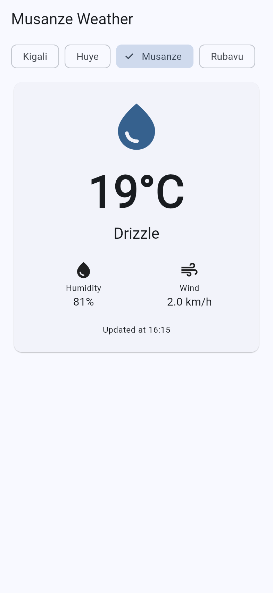
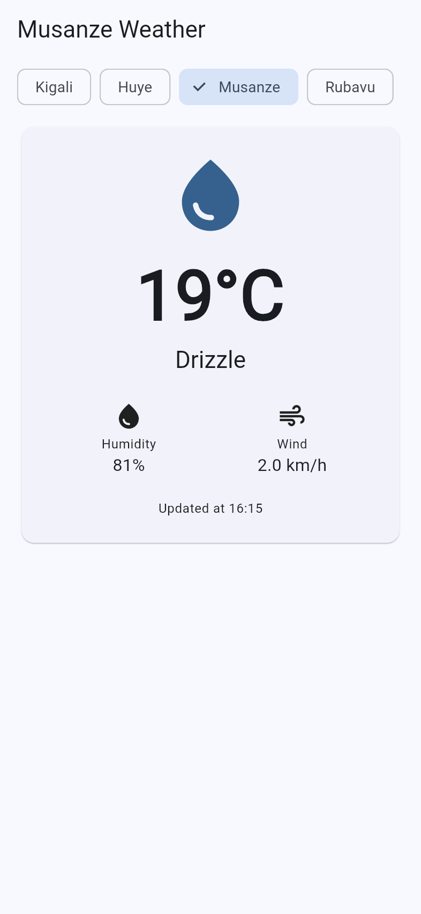
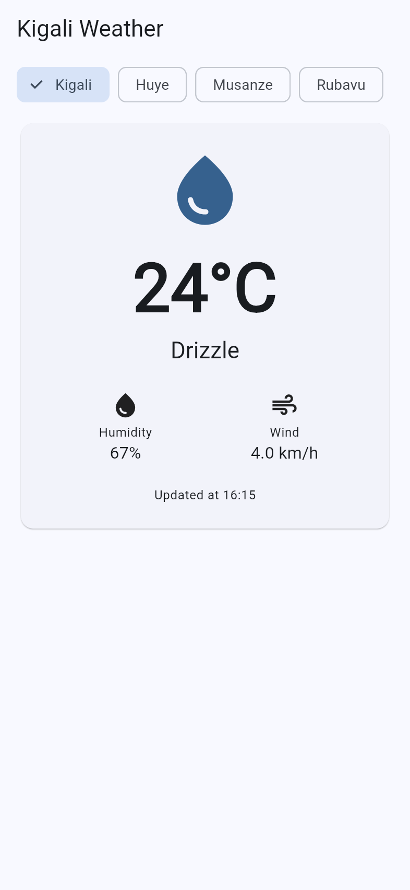
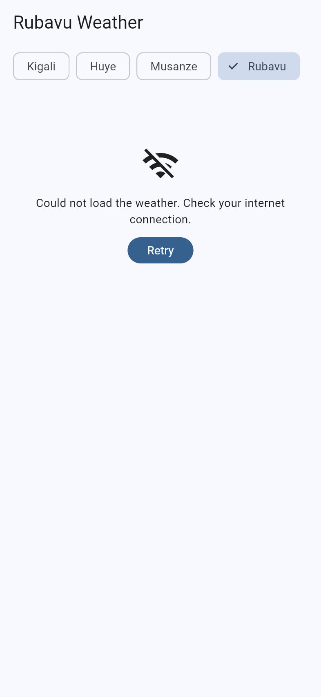

# kigali_weather

Live weather for Kigali, Huye, Musanze and Rubavu from the Open-Meteo API, with offline support.

My data is now saved on the phone with shared_preferences, so the last chosen city and its weather survive when the app closes, and it shows live temperature, humidity, wind and sky conditions from Open-Meteo.

## Screenshots

